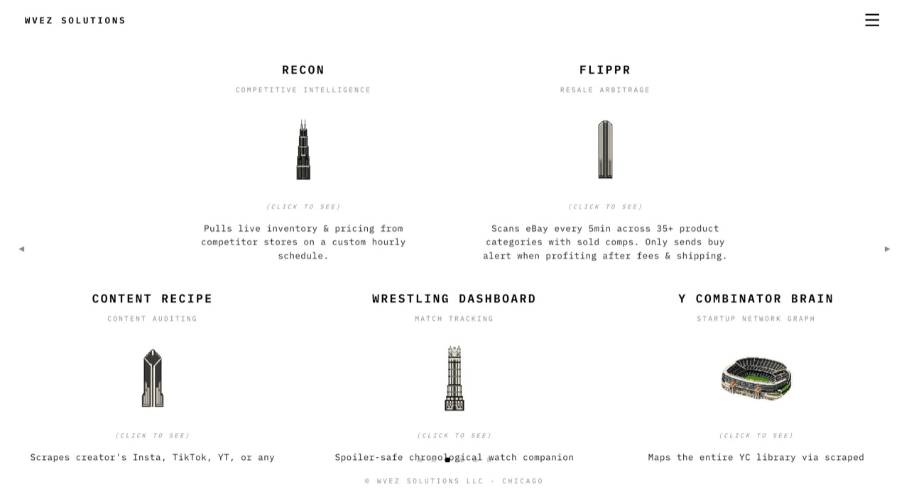

# wvez.org

The site for WVEZ Solutions, a one person automation studio in Chicago. It is the
portfolio, three interactive demos of workflows I have built, and a blog.



Live:

| | |
|---|---|
| [wvez.org](https://wvez.org) | The site. Six panels, a 3D pendant, a photo and video viewer |
| [wvez.org/recon](https://wvez.org/recon) | RECON, competitive inventory and pricing surveillance |
| [wvez.org/flippr](https://wvez.org/flippr) | FLIPPR, eBay resale arbitrage scanning |
| [wvez.org/crp](https://wvez.org/crp) | Content Recipe, creator content auditing |
| [wvez.org/#writing](https://wvez.org/#writing) | Writing, with an [RSS feed](https://wvez.org/feed.xml) |

## Stack

Hand written HTML, CSS and JavaScript. No framework and no build step for the site
itself. IBM Plex Mono throughout, black text on white, pixel art as the only color.
Hosted on GitHub Pages, which also builds the blog with Jekyll when it is turned on.

Each demo is a single self contained file. They run entirely in the browser, call no
real service, and the numbers they display are invented.

Visits are counted with [GoatCounter](https://wvez.goatcounter.com): one script tag at the
bottom of every page, demos included, no cookies. Email signups at the end of each post
go to Brevo through the site's own box, with no Brevo logo on the page. See
`docs/decisions.md`.

## Running it

```bash
python3 -m http.server 8000
```

That serves the landing page and the three demos exactly as they are. It does not run
Jekyll, so anything under `_layouts` or `_posts` will not render locally.

## Where writing lives

Writing is the fourth panel of the site, between Ventures and Photography, and it is the
index: one row per post, newest first, grouped by year. Clicking a row opens that post as
its own page at `/blog/<slug>`, which scrolls normally instead of living in the panel deck.

`index.html` carries Jekyll front matter for exactly one reason: so that panel can be
rendered from `_posts/`. Everything else in the file passes through untouched.

Every section is now linkable by hash, so `/#writing`, `/#ventures` and the rest all open
on that panel. `/blog` redirects to `/#writing`.

## Publishing a post

Add a file to `_posts/` named `YYYY-MM-DD-slug.md`:

```markdown
---
title: The title as it should read
date: 2026-09-22
description: One line. This shows on the index and in the RSS feed.
---
```

Write the body in markdown, then push. The post appears at `wvez.org/blog/slug/` in
about a minute, and the Writing panel and the feed update themselves. A post you are not
ready to publish goes in `_drafts/`, where it needs no date in the filename.

Post pages also carry a Notion style section outline, link previews that play on hover,
hover definitions for words, and inline workflow diagrams. [CONTRIBUTING.md](CONTRIBUTING.md) shows how to use each.

When a build fails, GitHub emails the error and keeps serving the last good version of
the site. To read the error:

```bash
gh api repos/warner-wvez/wvez-landing/pages/builds/latest --jq '{status,error:.error.message}'
```

## Layout

```
index.html          the site
crp/ flippr/ recon/ the demos, one file each, URLs are frozen
assets/             images, video, pixel art, the two 3D models
assets/blog/        the post page script, workflow diagrams, and each post's media
_posts/             published blog posts, one markdown file each
_drafts/            written but not published, no date needed in the name
_layouts/           the blog's shell and post template
_includes/          custom components: the aside box and four ways to show workflow diagrams
blog.html           redirects /blog to the Writing panel
docs/decisions.md   why the site is built this way
```

## House rules

- No em dashes and no emojis, anywhere.
- No large empty regions on any page or in any state.
- `/`, `/crp`, `/flippr` and `/recon` have been shared publicly. They do not move.

Commit messages go through `.githooks/commit-msg`. See [CONTRIBUTING.md](CONTRIBUTING.md).

## License

[PolyForm Noncommercial 1.0.0](LICENSE). Read it, learn from it, do not sell it.
